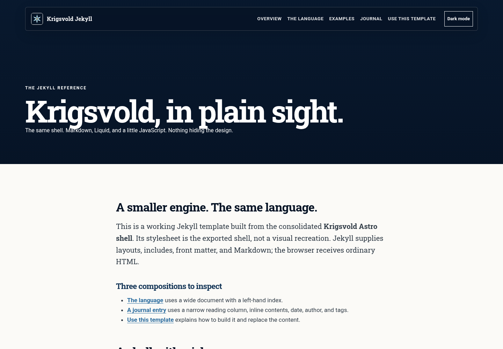
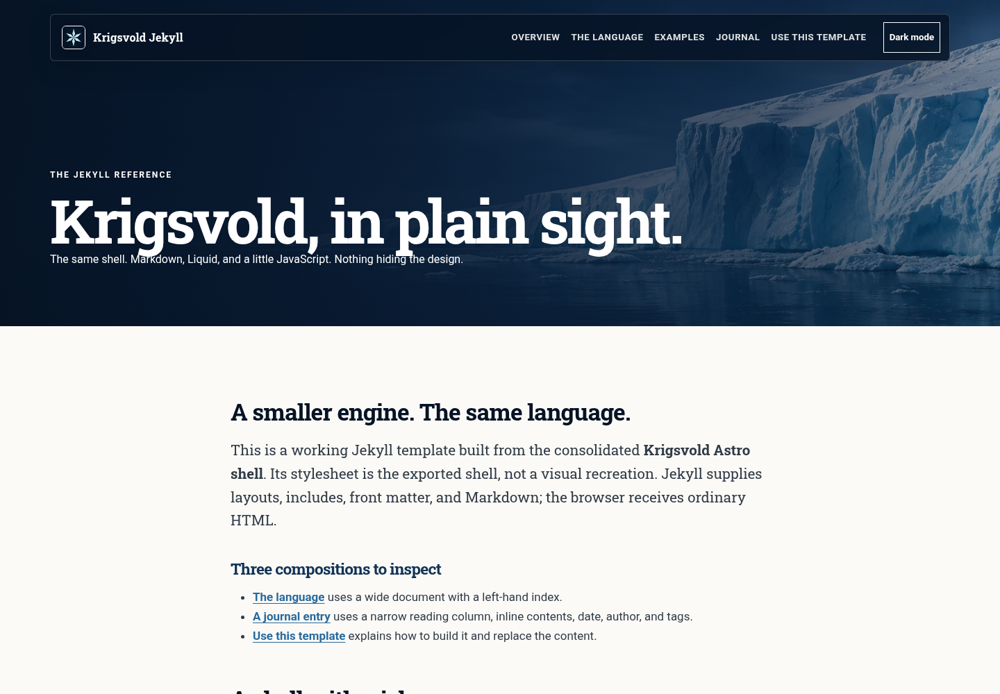
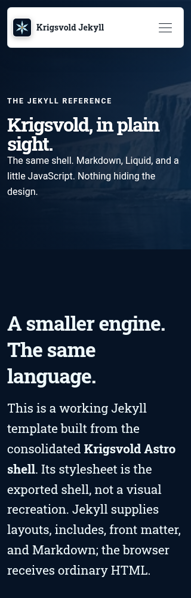

# Initial native Preview visual evidence

These screenshots show the unchanged production reference before integration and the actual HTTPS development Preview after the initial manual bootstrap. They do not claim automatic Git deployment; that is verified separately after the next develop integration.

- Preview: https://develop-krigsvolddesign-jekyll-reference.k3jph.workers.dev
- Deployed source commit: `07c86d116ce2d8cac149c0b2b8185d240b9517e4`
- Payload SHA-256: `fbdc56ba01b9bb615f792b64e2db5187fa234da026ca8a6de73fafd3ae042b56`
- Original artwork bytes match the approved archive recorded in issue #88.
- Root and `/preview` were checked at desktop, tablet and mobile sizes in light/dark modes. Both actual previews received 14 visual frames and 100 canonical recipe HTTP checks each. Complete-file verification covered the live payload, source ZIPs, and preserved frozen documentation.
- Responses have `noindex` and `no-transform`; no missing assets or horizontal overflow were found in the primary frames. Manual screenshot inspection supplements automated checks; manual assistive-technology certification is not claimed.

| Before: production | After: development Preview |
| --- | --- |
|  |  |

The initial forced-colors menu icon was visually empty. This follow-up adds a scoped visible Menu/Close cue and keyboard regression checks; its deployed state must be rechecked after integration. Normal imagery and palettes are unchanged.
